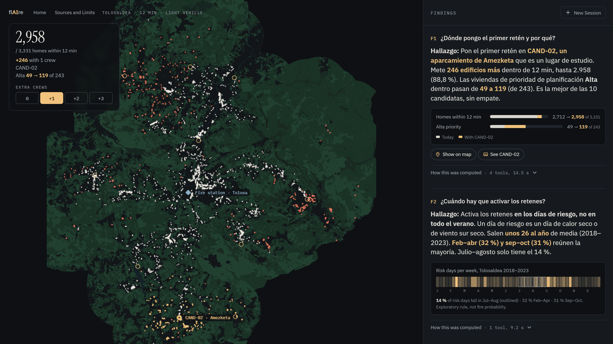

# flAIre · where should the next wildfire crews go?

flAIre is a data agent for the fire-prevention planner of Gipuzkoa (Basque Country, Spain). It answers one question for the district of **Tolosaldea**: *where should up to N extra preventive crews (retenes) go, and what does each one add?* Every number comes from a tool call on open data, with its source and its limits next to it.

Built by team urbAIn for the Gipuzkoa AI Hackathon 2026 (Urban Challenge, top-3 finalist) and presented at the MIT City Science Summit, Tools Workshop (5 Nov 2026, Tabakalera, Donostia).



## The answer, in numbers

Within **12 minutes by road** (light vehicle), today's 9 fire stations reach **2,712 of 3,331 homes (81.4 %)** that sit within 100 m of forest or scrub.

| Extra crews | Sites | Homes within 12 min | High-priority (Alta) homes |
|---|---|---|---|
| 0 | today | 2,712 (81.4 %) | 49 of the 209 reachable |
| 1 | Amezketa (CAND-02) | 2,958 (88.8 %), +246 | 119 |
| 2 | + Asteasu (CAND-01) | 3,083, +125 | 165 |
| 3 | + Berastegi (CAND-03) | 3,187 (95.7 %), +104 | 177 |

**What holds and what doesn't.** Amezketa and Berastegi are in the best three sites at 10, 12 and 15 minutes and with both vehicle types. The third site changes (CAND-01, 08 or 10) and wins by only 3 to 19 buildings (6 at the headline), so it is the planner's judgement call, not ours (`app/data/stability.json`). On the orthophoto, CAND-01 is a roadmen's house with no yard: one more reason it is a judgement call. All of this is with every building weighted 1; we make no claim across weightings.

**When.** Only 14 % of risk-weather days fall in July–August; 32 % fall in February–April and 31 % in September–October (`app/data/weekly_calendar.json`). Weather says *when* to activate crews, not *where*.

**Beyond Tolosaldea.** Today's coverage for all of Gipuzkoa: 20,908 of 25,323 exposed homes (82.6 %) within 12 minutes; Tolosaldea ranks 4th of 7 districts (`app/data/gipuzkoa_baseline.json`). Crews were placed only in Tolosaldea.

"Homes" means residential buildings (they hold 10,651 dwellings), not people.

## Run it

Python 3.11. The geospatial stack is easiest from conda-forge (see the comments in `requirements.txt`).

```bash
pip install -r requirements.txt -r app/requirements-web.txt
cp .env.example .env          # add your ANTHROPIC_API_KEY
python app/server.py          # http://localhost:8770
```

Ask in Spanish, e.g. «¿Dónde pongo el primer retén y por qué?». The answer shows the tool calls behind it, the map relights with the crews, and a study site can show its orthophoto.

Check the numbers without an API key:

```bash
python -m pytest -q tests          # 64 passed, 11 skipped (the 11 need the pipeline rebuilt from raw data)
python pipeline/qa_evidence.py     # every number in docs/QA.md
python app/run_agent_once.py "¿Dónde pongo el primer retén?"   # one full agent answer (needs the key)
```

## How it works

1. **Homes at risk:** residential buildings from the official cadastre (B5M) within 100 m of forest or scrub in the 2024 Forest Map, 28 municipalities.
2. **Priority:** each home gets Alta / Media / Baja planning priority from distance to vegetation, vegetation type and current access (`agent/data/REGLAS_prioridad.md`). It is a planning priority, not a fire probability.
3. **Travel times:** 532,000 estimated road times on the OpenStreetMap network, from the 9 stations and 10 candidate study sites, for a light vehicle and a truck.
4. **Optimizer:** tries every combination of 0 to 6 of the 10 sites (848) and keeps the one that brings the most homes inside the threshold (`pipeline/optimizer.py`).
5. **Agent:** a LangChain agent with 10 deterministic tools over that data (`agent/`). The model writes the sentences; every number comes from a tool, and `comprobar_cifra` recounts it independently.

## Repository map

| Folder | What it holds |
|---|---|
| `agent/` | The FINAL agent: prompt, 10 tools, data layer, report maps; `CHANGES.md` says what changed from v3 and since the hackathon |
| `agent/data/` | The data the agent reads (CSV/JSON, 2 MB) with a data dictionary and the priority rules (Spanish) |
| `app/` | Web app: stdlib server, static page, map, the off-platform agent runner |
| `app/data/` | JSON tables the screens read, each written by a tested exporter in `pipeline/` |
| `pipeline/` | Rebuild from raw data, the exhaustive optimizer, exporters, `qa_evidence.py`; `pipeline/priority/` builds the priority score |
| `data/` | Small inputs the tests need, the database schema, and how to download the large layers (`data/README.md`) |
| `reports/` | `sources.csv` (URL, licence, date, sha256 per dataset), data-quality reports, link validation (12/12 hand checks), candidate site records, orthophotos |
| `tests/` | The test suite |
| `deck/` | The 2-minute talk and its screenshots |
| `docs/` | `flaire_how_it_works.pdf` (how the code works, chapter by chapter, with file and line for every point), `QA.md` (hard questions with the evidence behind each answer) and real agent transcripts with claim-by-claim checks |

## Honest limits

- Travel times are **estimates** on assumed speeds (about 85 % of roads have no speed limit tagged), not response times; there is no turnout time. The 12-minute threshold is for the study, not an official target.
- Candidate sites are **study locations, not authorised bases**: shelter, water, turning space, radio and permission are unchecked.
- There are **no stations outside Gipuzkoa** in the data (Navarra, Bizkaia, Araba), so border areas can look worse than they are.
- Risk-weather days come from an exploratory rule on 3 Euskalmet stations (2018–2023), not FWI and not fire probability; the 3 weather zones can't be told apart.
- FireScope (INSAIT) is a third-party AI model, used only as an experimental comparison, never in the score.
- The weather part of the priority score is switched off (0 for every home), so the "meteo" weighting is inert.
- Nothing here is official cartography or an operational plan.

## Data and licences

Code: MIT (`LICENSE`). Data: see `DATA_LICENSE.md` and the attributions in `NOTICE.md`. Every source dataset is listed with its URL, licence, download date and checksum in `reports/sources.csv`.

## Team

urbAIn: Felipe Salazar, Carlos Tesoriero, Luca Castagnet, Santiago Mariño (Tecnun – Universidad de Navarra). Built by humans directing AI coding agents; the errors the agents made, and how we caught them, are in `docs/QA.md` and `docs/transcripts/`.
