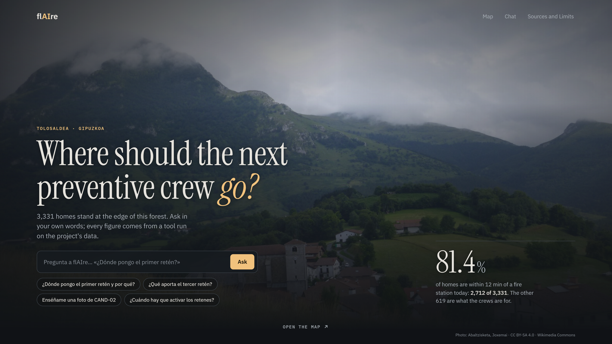
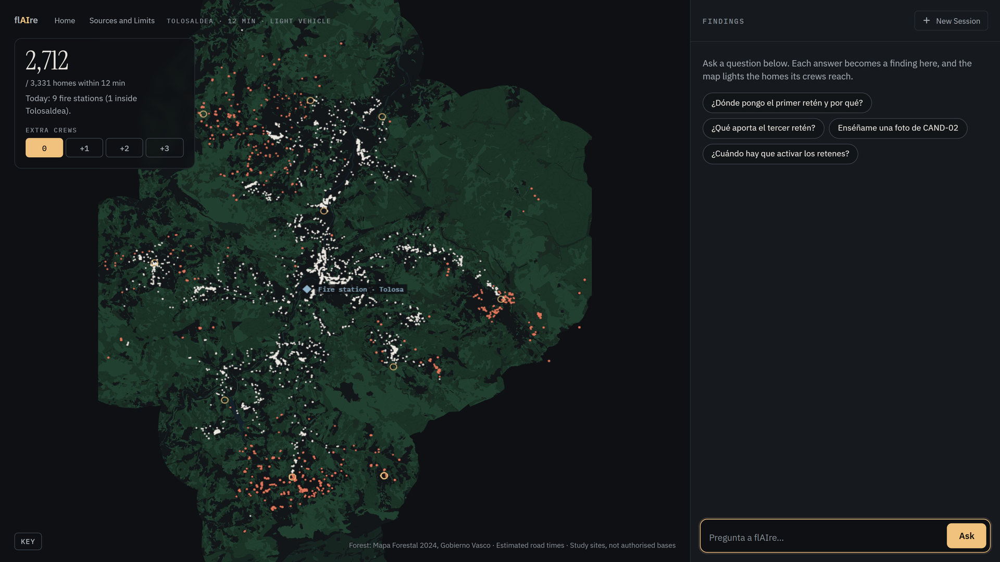
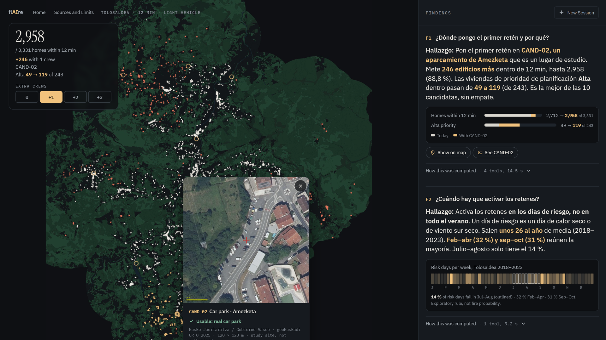
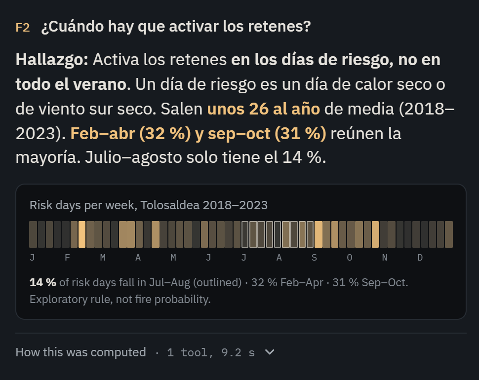

# flAIre · the 2-minute talk

MIT City Science Summit, Tools Workshop · 5 Nov 2026, Tabakalera (Donostia). English, two blocks: motivation and impact (slides 1–2), the tool (slides 3–6). Spoken text is in the quote lines (260 words). Version of 28 Oct 2026.

## Block 1 · Motivation and impact

### Slide 1 · Hook (15 s)

> In 2025, Gipuzkoa's firefighters were called to 81 forest fires, more than double the year before. How long until a crew reaches your home? In Tolosaldea, 3,331 homes sit within 100 metres of forest or scrub.

Photo: Abaltzisketa below Txindoki, by Joxemai, Wikimedia Commons, CC BY-SA 4.0.

### Slide 2 · The problem (25 s)

> Today, nine fire stations reach 2,712 of them within 12 minutes by road: 81.4 percent. The rest wait longer. The province can add a few preventive crews, and every crew costs people and money. So the planner's question is: where should the next crews go, and what does each one add?

12 minutes is estimated road travel time, not response time, and not an official target. The fire service's own target is an outward trip under 15 minutes, met in 83 % of 2025 call-outs (all incident types).

## Block 2 · The tool

### Slide 3 · The tool (30 s)

> flAIre answers that question. Choose how many crews you can afford, from zero to six. flAIre tries every combination of ten candidate sites, using estimated road travel times, and shows which homes each crew brings inside 12 minutes. Ask it why, and every number comes with its source and its limits.

The real web app answering «¿Dónde pongo el primer retén y por qué?». Candidate sites are study locations, not authorised bases.

### Slide 4 · The answer (20 s)

> The first crew goes to Amezketa: 246 more homes, 88.8 percent. With three crews, 95.7 percent. Amezketa and Berastegi win under every threshold and vehicle we tested. The third site changes, so that choice is the planner's, not ours.

Third site: wins by 3 to 19 buildings across thresholds and vehicles (6 at the headline), every building weighted 1. High-priority homes: 49 → 177 of the 209 we can reach. Orthophoto: Eusko Jaurlaritza / Gobierno Vasco, geoEuskadi.

### Slide 5 · How we built it (20 s)

> Four students directed a team of AI agents. They narrowed 124,140 buildings to 3,331 and computed 532,000 travel times. They got things wrong: the first candidate sites were restaurants, and one mis-tagged road distorted results. We planned for summer; the data says spring and autumn. We fixed every one.

Risk-weather days, not fires: an exploratory rule on 3 Euskalmet stations, 2018–2023. Jul–Aug 14 %, Feb–Apr 32 %, Sep–Oct 31 %.

### Slide 6 · What's next (10 s)

> We've measured all of Gipuzkoa: 82.6 percent of homes within 12 minutes; Tolosaldea ranks fourth of seven districts. We think flAIre could place ambulances. What we need now is one planner to try it.

Screen: Gipuzkoa's 7 districts shaded by coverage, Tolosaldea outlined (in progress).

Province figure is today's coverage only; crews were placed only in Tolosaldea. Stations outside Gipuzkoa are not in the data, so border areas can look worse than they are.

## Sources for the spoken numbers

| Number | Source |
|---|---|
| 81 forest-fire call-outs in 2025, 38 in 2024 (all Gipuzkoa) | SPEIS Gipuzkoa, *Memoria anual 2025*, p. 37 |
| 3,331 homes; 2,712 (81.4 %) today; +246 (88.8 %); 95.7 % with three crews | `agent/data/`, `app/data/tolosaldea.json`, pinned by `tests/` |
| Two robust sites, third site a judgement call | `app/data/stability.json` |
| 124,140 → 3,331 buildings; 532,000 travel times | `reports/quality_territory_buildings.md`, `reports/linker_validation.md` |
| Spring and autumn, not summer | `app/data/weekly_calendar.json` |
| 82.6 % of Gipuzkoa; Tolosaldea 4th of 7 | `app/data/gipuzkoa_baseline.json` |

Every number is re-derived by `python pipeline/qa_evidence.py`; the hard questions and their answers are in `docs/QA.md`.
